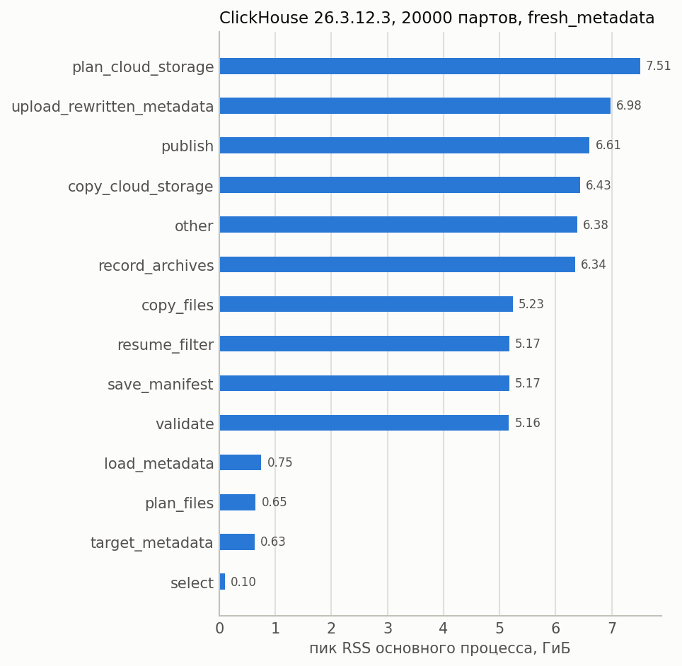
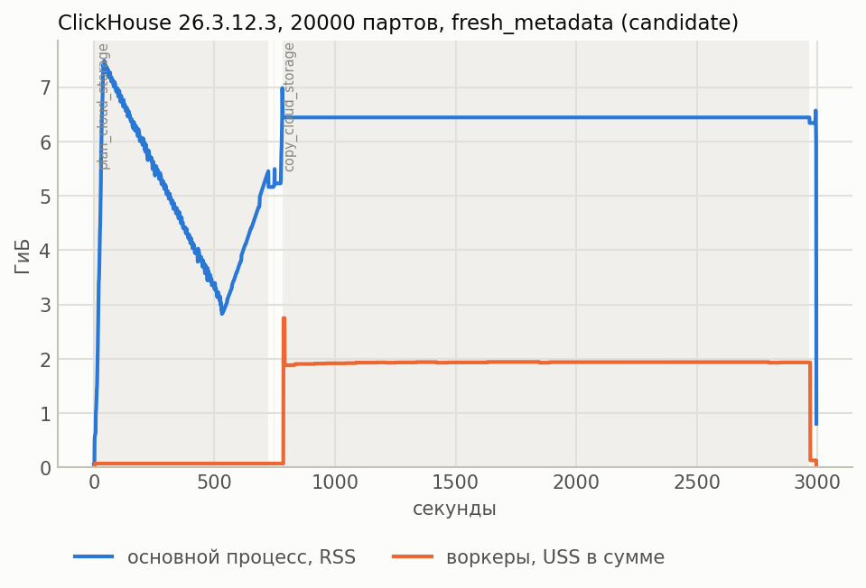
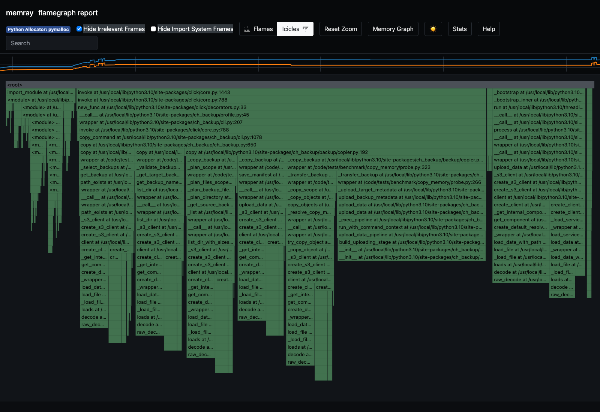

# Оптимизация памяти ch-backup и A/B тестирование

Основные потребители RAM при copy — распакованные метаданные, общий план объектов
и сведения для resume. Подготовленные оптимизации переносят большие структуры
на SSD и ограничивают объём данных, обрабатываемых за один раз.

Ветка `feat/copy-bounded-memory` проверена в A/B на 10k партов; перенос структур
на SSD увеличил время планирования и resume. В `feat/copy-plan-speed` подготовлены
[правки скорости и следующий A/B](README.md#ускорение-планирования-и-resume).
Их эффект ещё не измерен. Харнесс снимает профили после каждой точки и ограничивает
ожидание очистки.

## Исходные замеры

ВМ: 64 vCPU, 128 ГиБ RAM. ClickHouse 26.3.12.3, 120 колонок, Wide-парты,
метаданные диска версии 5.

| Показатель | 10 тысяч партов | 20 тысяч партов |
|---|---:|---:|
| Уникальных объектов S3 | 3,48 млн | 6,96 млн |
| Пик RAM основного процесса при планировании | 4,01 ГиБ | 7,51 ГиБ |
| Время планирования | 6,4 минуты | 12,4 минуты |
| Копирование метаданных, включая планирование | 24,8 минуты | 50,0 минуты |
| Пик RAM одного воркера при копировании метаданных | 1,51 ГиБ | 2,99 ГиБ |

Полное содержимое S3 в этих прогонах не копировалось. Подготовка исходного backup
на 20k отдельно заняла 2 часа 26 минут. На 30k бюджет закончился во время подготовки;
замеров copy для 30k и целевых 120k пока нет.



Пик приходится на `plan_cloud_storage`. Столбцы показывают RAM всего процесса
на этапе, включая ранее созданные структуры. Их нельзя складывать или считать
памятью, выделенной только текущей функцией.

## Подготовленные оптимизации

### 1. Ограничить выход распаковщика

Очередь ограничивала число кусков данных, но каждый распакованный gzip-кусок
мог быть огромным. Теперь распаковщик сразу выдаёт порции не больше
`filesystem.chunk_size`, не создавая большой промежуточный объект.
В A/B проверяем ранний пик RAM и неизменность распакованного содержимого.

### 2. Хранить метаданные на SSD

Миллионы metadata-файлов удерживались в Python-списках; передача их воркеру
добавляла упаковку сообщения и копирование данных. Теперь содержимое читается
последовательно и сохраняется во временный tar-архив, а воркер получает путь
к нему. Контрольная сумма считается при записи.

Так мы избегаем и больших списков в RAM, и миллионов отдельных временных файлов.
Проверяем память основного процесса и воркеров, скорость и расход SSD. Текущий metadata-файл
по-прежнему может находиться в памяти целиком.

### 3. Перенести план в SQLite

План и индекс адресов назначения росли вместе с числом объектов. Теперь они
хранятся в локальной базе SQLite, читаются пачками по 128 записей и используют
ограниченный кеш.

Обход плана не делает отдельный запрос на каждый объект. При обновлении записи
значение сериализуется один раз.

Проверка конфликтов остаётся общей: если разные источники претендуют на один
целевой адрес, это должно обнаружиться до копирования. Секреты доступа
в индекс не записываются. Проверяем RAM, время работы с базой и сохранение
проверок повторов и конфликтов между партами.

### 4. Обрабатывать resume порциями

Раньше в памяти одновременно находились план, подтверждения журнала и список
целевых объектов. Теперь список объектов S3 читается страницами, журнал — последовательно,
а результаты сохраняются в SQLite.

Пропуск объекта требует двух подтверждений: записи об успехе в журнале и наличия
целевого объекта нужного размера. Повреждённый журнал не должен оставлять частично
импортированные подтверждения. Это проверяется полным resume с большим числом
скопированных объектов; режим «только метаданные» такую нагрузку не воспроизводит.

### 5. Ограничить журнал при ошибках S3

При неудачной отправке журнала подтверждения продолжали накапливаться в RAM.
Теперь они сохраняются на диск, а повторная отправка ограничена числом записей
и примерно 16 МиБ исходного текста. Ошибка не удаляет неотправленные данные.
Проверяем память при длительных ошибках записи и корректность повторных попыток.

### 6. Записывать JSON постепенно

Публикация описания бэкапа создавала дополнительные структуры и полную JSON-строку.
Теперь JSON записывается частями с сохранением прежнего формата и старых ссылок
на парты. Проверяем пик RAM и совместимость с восстановлением.

Исходное описание бэкапа и отдельная копия описания назначения пока остаются
в памяти. Поэтому расход RAM всей программы ещё зависит от размера таблицы.

### 7. Ускорить частые операции со строками

Для строк без специальных символов добавлен быстрый возврат без лишнего
экранирования. Выигрыш проверяем по CPU-профилю и времени планирования.
Повторный разбор метаданных, подготовка диагностических строк и стоимость gzip —
следующие кандидаты для исследования, без обещанного выигрыша.

Перенос данных на SSD может увеличить время и дисковый I/O. В A/B оцениваем
этот обмен вместе с RAM; корректность копирования и восстановления проверяем отдельно.

## Пайплайн A/B

A — исходная версия `127ea3c`, B — текущий коммит ветки `feat/copy-bounded-memory`.
Они запускаются последовательно на одной ВМ с одинаковыми настройками.

1. **Подготовка.** Выбираем N партов и одну версию ClickHouse. Создаём таблицу,
   проверяем парты, делаем один исходный backup для A и B, считаем реальные файлы
   и объекты. Целевые префиксы у версий разные.
2. **Фиксация кода.** Обе ревизии помещаются в отдельные каталоги исходного кода. В результаты
   записываются SHA, путь импортированного пакета и хеш его Python-файлов.
3. **Обычные замеры.** По умолчанию измеряем planning, а для metadata v5 ещё
   metadata-only и его resume. Делаем три повтора, чередуя порядок A/B.
   Кеши ОС не сбрасываем. Для передачи всех S3-объектов есть `--copy-mode full`.
4. **Профили.** После обычных замеров повторяем сценарии на том же backup:
   отдельно с py-spy для CPU и с Memray для RAM. Профили есть у обеих версий.
   Эти повторы не входят в основное A/B, поскольку профайлер сам расходует ресурсы.
5. **Сравнение.** В отчёт попадают медианы времени, учтённого CPU и RAM только
   успешных пар одинакового сценария и повтора. Например, Δ −30% означает
   уменьшение показателя у B относительно A.
6. **Очистка.** Сохраняем логи и удаляем окружение. Отдельный таймаут ограничивает
   ожидание; при его превышении серия получает `cleanup_failed`, следующая точка
   не стартует. Docker может продолжать удаление в фоне.

Для лестницы: **10k — замеры и профили → очистка → 20k — замеры и профили →
очистка → 30k — замеры и профили**. Профиль завершившегося процесса нельзя снять
задним числом, поэтому нужны отдельные повторы.

Телеметрия записывается во время работы. Отчёт обновляется после backup, каждого
copy и периодически во время copy. При падении уже записанные замеры сохраняются.
Общий бюджет ограничивает время, но не гарантирует завершение всей лестницы.

## Как читать графики

### Память во времени



Синяя линия — RSS основного процесса, оранжевая — суммарный USS воркеров
(только их собственные страницы памяти). Это разные показатели, их сумма
не равна общему расходу RAM. Видны ранний пик и длительное удержание памяти.

На старом графике `candidate` — имя единственного варианта запуска. Это код
до оптимизаций, а не результат нового A/B.

### Профиль памяти



Пример получен на двух партах и 120 колонках. Прямоугольники — функции и цепочки
вызовов; ширина показывает вклад в память на пике. Родитель включает дочерние
вызовы, поэтому ширины разных уровней не складываются. Горизонтальная ось дерева
не является шкалой времени.

В smoke заметны создание клиента S3 и загрузка его описаний. Это не доказывает,
что они определяют расход RAM на большой таблице: для каждого N снимается
собственный профиль.

По умолчанию Memray сохраняет агрегированный профиль: `peak` показывает удержание
памяти на пике, `leaks` — оставшиеся выделения в конце записи, не обязательно утечки.
Для temporal/temporary нужен более тяжёлый `--memory-format all`.
При SIGKILL агрегированный профиль может потеряться; внешние отсчёты RAM останутся.
[Подробнее о форматах Memray](https://bloomberg.github.io/memray/api.html#memray.FileFormat).

### Профиль CPU

py-spy снимает выборки стеков основного процесса и воркеров; JSON открывается в Speedscope.
Широкая ветвь означает частое попадание в выборку. По умолчанию записываются
до трёх окон по 120 секунд, поэтому профиль не охватывает весь долгий copy.
Границы окон сохраняются. Общий CPU считаем по процессам, ожидание S3 — по запросам.

## Запуск и результаты

На выделенной Linux ВМ, из каталога репозитория, с правами root:

```sh
make test-benchmark-copy-memory-ab \
  BENCH_PARTS=10000 \
  CLICKHOUSE_VERSIONS=26.3.12.3 \
  BASELINE_REF=127ea3c \
  CANDIDATE_REF=HEAD \
  BENCH_REPEATS=3 \
  BENCH_ARGS='--total-budget-hours 12 --cleanup-timeout 1800'
```

`BENCH_PARTS` заменяется на нужное N. Ревизии должны быть доступны локально,
а checkout харнесса — содержать новую цель Makefile. Остальные параметры —
в [README](README.md).

Лимиты по умолчанию: 2 часа на профилируемый copy, 15 минут на отчёт Memray,
30 минут ожидания очистки, 4 ГиБ файлов Memray на точку и минимум 20 ГиБ
свободного диска. Таймаут очистки не устраняет замедление файловой системы.

| Файлы | Содержимое |
|---|---|
| `report.md`, `comparison.json` | Результаты, ошибки и сравнение A/B |
| `options.json`, `probe.json` | Ревизии, настройки и фактически загруженный код |
| `samples.csv`, `stages.jsonl` | Замеры, включая частичные |
| `cpu-*.speedscope.json`, `memory-*-peak.html` | Профили CPU и памяти |
| `point.json`, `series.json`, `cleanup.log` | Состояние работы и очистки |

## Источники примеров

Замеры и графики 20k: серия `20261101T233239-overnight`, ClickHouse 26.3.12.3.
Flamegraph: `20261101T225256-smoke`, `control_memory_1-candidate`, процесс 4389.
PNG сохранены без изменений; исходные результаты — в `staging/benchmark-results/`.
